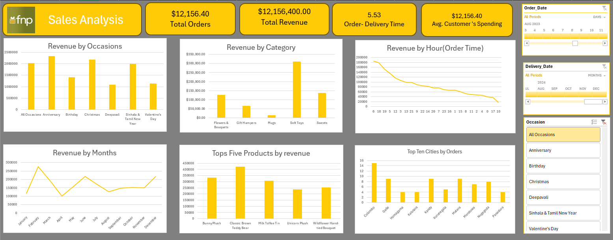

# 🎁 FNP Sales Analysis Dashboard

An interactive **Excel dashboard** analysing gifting and flower sales for **FNP** in Sri Lanka. It turns raw order, customer and product data into clear insights on revenue, product performance, customer behaviour, delivery speed and seasonal trends.



---

## 📌 Project Overview

The goal of this project is to help the business answer questions such as:

- Which **occasions** and **product categories** generate the most revenue?
- Which **products** are the top sellers?
- Which **months** and **hours of the day** drive the most sales?
- Which **cities** place the most orders?
- How quickly are orders **delivered**?
- How much does the average customer spend?

---

## 📊 Dashboard Features

**KPI cards**

| KPI | Description |
|-----|-------------|
| Total Orders | Number of orders in the selected period |
| Total Revenue | Sum of sales for the selected filters |
| Order–Delivery Time | Average time (days) between order and delivery |
| Avg. Customer's Spending | Average revenue per customer |

**Charts**

| Chart | Insight |
|-------|---------|
| Revenue by Occasions | Compares Anniversary, Birthday, Christmas, Deepavali, Sinhala & Tamil New Year, Valentine's Day |
| Revenue by Category | Flowers & Bouquets, Gift Hampers, Mugs, Soft Toys, Sweets |
| Revenue by Hour (Order Time) | Shows peak ordering hours of the day |
| Revenue by Months | Reveals seasonal sales trends across the year |
| Top Five Products by Revenue | Best-selling products |
| Top Ten Cities by Orders | Geographic demand across Sri Lanka |

**Interactive filters (slicers & timelines)**

- 📅 **Order Date** timeline
- 🚚 **Delivery Date** timeline
- 🎉 **Occasion** slicer

---

## 🗂️ Repository Structure

```
fnp-sales-analysis-dashboard/
├── Book1.xlsx        # Excel workbook with data model, pivot tables & dashboard
├── customers.csv     # Customer data
├── orders.csv        # Order transactions
├── products.csv      # Product catalogue
├── dashboard.png     # Dashboard screenshot
└── README.md         # Project documentation
```

---

## 🛠️ Tools & Techniques

- **Microsoft Excel**
  - Data cleaning & transformation (Power Query)
  - Pivot Tables & Pivot Charts
  - Slicers & Timelines for interactivity
  - Calculated fields / formulas for KPIs
- **CSV** datasets as the data source

---

## 🚀 How to Use

1. **Clone** the repository
   ```bash
   git clone https://github.com/DimuthuMadhawa/fnp-sales-analysis-dashboard.git
   ```
2. Open **`Book1.xlsx`** in Microsoft Excel (2016 or later recommended).
3. If prompted, click **Enable Content** / **Refresh All** so pivot tables update.
4. Use the **Order Date**, **Delivery Date** and **Occasion** filters to explore the data.

---

## 🔍 Key Insights

> Update these with the exact figures from your final analysis.

- **Soft Toys** are the highest-earning category by a wide margin.
- **Anniversary** and **Christmas** are the top revenue-generating occasions.
- Revenue peaks in **February** (Valentine's season) and again around **June** and **December**.
- **Colombo** places the most orders, followed by cities such as Galle, Kandy, Matara and Nugegoda.
- Order volume is highest in the **early hours** of the day and declines steadily through the day.
- Best-sellers include the **Classic Brown Teddy Bear**, **Bunny Plush** and **Milk Toffee Tin**.

---

## 💡 Recommendations

- Increase stock and run promotions for **soft toys** ahead of peak seasons.
- Plan campaigns around **Valentine's Day, Christmas and Anniversary** periods.
- Target marketing at **peak ordering hours**.
- Expand delivery capacity and marketing in **high-demand cities**.

---

## 🔮 Future Improvements

- Rebuild the dashboard in **Power BI** or **Tableau**
- Add customer segmentation and repeat-purchase analysis
- Add profit margin analysis
- Add sales forecasting

---

## 👤 Author

**Dimuthu Madhawa**
GitHub: [@DimuthuMadhawa](https://github.com/DimuthuMadhawa)

---


